<picture>
  <source media="(prefers-color-scheme: dark)" srcset="./assets/profile-dark.svg">
  
</picture>

## Hi, I'm Nora 👋

写 Python 和 Rust，最近在做 [KeyVault-AI](https://github.com/NoraStory/KeyVault-AI) 和 [DeepSeek Harness](https://github.com/NoraStory/deepseek-harness)。做的大多是给自己用的工具。

- 🔭 **KeyVault-AI**：把 AI 密钥和配置放在一个地方，本地就能管理。
- 🌱 最近在学 CUDA 和 Triton，想看看模型推理的时间都花在哪。
- 🧰 顺手能用：Python、Rust、TypeScript、Go、C / C++、Svelte、Tauri。
- 💬 有项目问题或者想聊本地工具，欢迎开 issue。
- 📫 博客：[CSDN](https://blog.csdn.net/storyseekee) ｜ [Gitee](https://gitee.com/storyseeker)
