<picture>
  <source media="(prefers-color-scheme: dark)" srcset="./assets/banner-dark.svg">
  
</picture>

我做小而锋利的工具。先给自己的机器用，再给碰巧需要它的人。喜欢贴着底层写代码，也会在问题不在机器本身时坦率地拿起框架。

### 在做的东西

- **[KeyVault-AI](https://github.com/NoraStory/KeyVault-AI)**：本地的 AI 密钥与配置管理中枢。Tauri v2、Rust、Svelte。
- **[deepseek-harness](https://github.com/NoraStory/deepseek-harness)**：给 DeepSeek 用的插件化运行框架，功能都从插件接入。
- **[AgenticLearningSystem](https://github.com/NoraStory/AgenticLearningSystem)**：本地学习系统，陪自己学 C++ 和 Python。
- **[algomind](https://github.com/NoraStory/algomind)**：算法练习，用 Go 写。

### 写代码时在意的事

- **本地优先**：数据先留在自己的机器上，同步应该是选择，不是默认。
- **读懂源码**：文档描述意图，代码才说真话。
- **三次就重写**：同一个工具烦到我三次，就该重写了。
- **安静软件**：不要遥测，不要弹窗，不要诱导性设计。

### 写字的地方

[CSDN](https://blog.csdn.net/storyseekee) · [Gitee](https://gitee.com/storyseeker)

有 issue 或讨论都可以。回得慢，修得认真。
